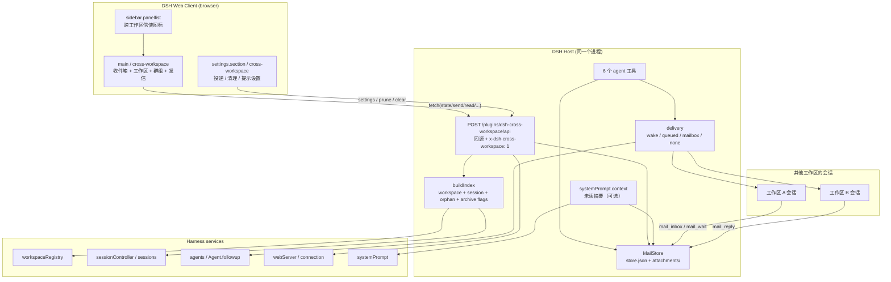
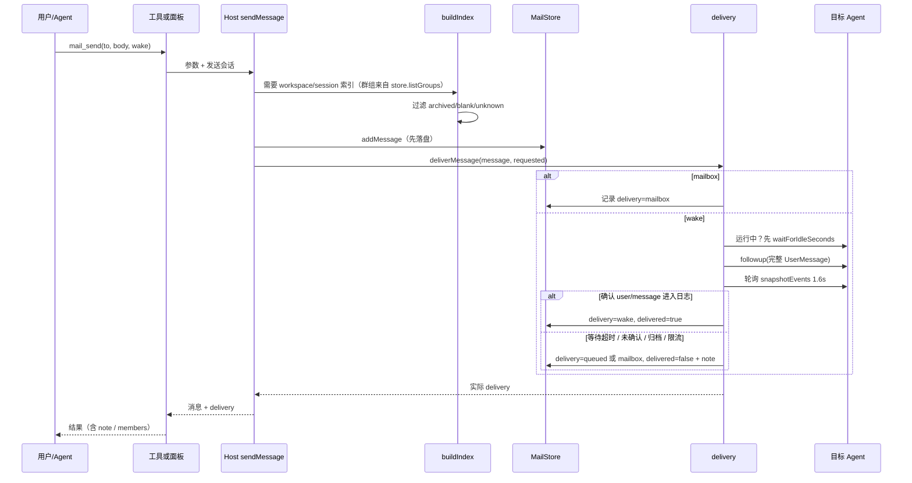
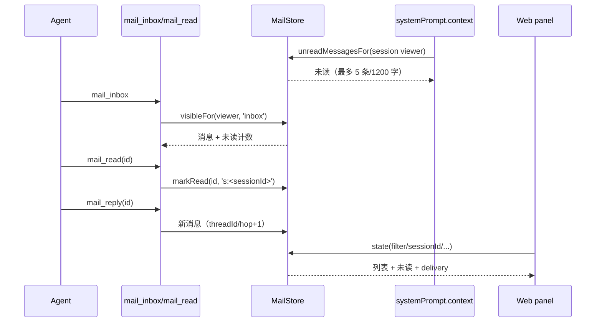
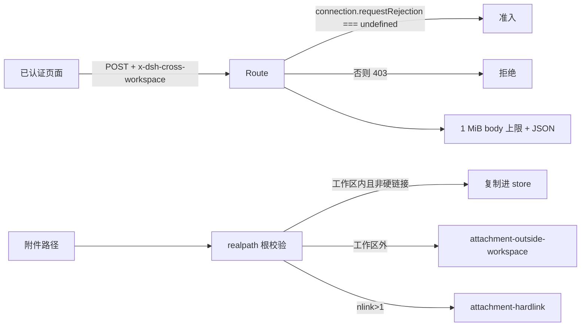

# 架构说明 · dsh-cross-workspace

> 人群：需要改代码/排查问题的开发者，以及需要理解调用链的 AI。
> 契约字段以 [`API.md`](API.md) 为准；操作规则见 [`../AGENTS.md`](../AGENTS.md)。

- 版本：`0.8.2`
- 最后同步：2026-11-07
- 运行范围：本机同一个 DSH Host 进程
- 数据位置：`$DSH_HOME/cross-workspace/`（`store.json` + `attachments/`）

---

## 1. 组件与边界



**边界原则**

- **Host 是唯一业务入口**：投递、过滤、群组、寻址、校验都在 Host。Client 只请求 `state`/`send` 等 action 并展示。
- **交流图是纯 Client 派生视图**：从 `state.messages`（最多加载 300 条，图取最近 120 条）构图，不新增 Host API、不改投递；
  节点=彩色卡片（会话/工作区广播/群组），边=消息方向，颜色跟随发送方；投递状态显示在时间线/详情；刷新/轮询只更新数据，不写 store。
- **Harness 是唯一会话真相**：插件不写 Session 日志、不新增事件类型；所有“哪个会话存在/是否归档/是否运行”都从服务读。
- **信箱是本机持久层**：消息先落盘，再投递；即使目标不可达也不丢。

---

## 2. 一次发信的数据流



关键点：

1. **先写 store，再投递**：投递失败只影响 `delivery`，消息仍可被收件方以后读到。
2. **wake 确认**：`followup` 只是入队；必须看到本次生成的 `user/message` id 才算启动。
3. **群组**：`to.memberSessionIds` 快照在 `addMessage` 时确定；只有请求 `wake` 时才逐成员投递并写
   `delivery.members`；纯 mailbox 群发在 `deliverMessage` 早期返回，不产生 members，也不调用目标 agent。

---

## 3. 收信与已读



**查看者语义**

- 会话读信：`s:<sessionId>`，每个会话独立已读；
- 面板未选中会话：显式传 `workspacePath` 时可用 `w:<规范化工作区路径>`；当前面板管理视角实际不传，
  因此是“无 viewer”模式（`MailView.read` 恒 false，按管理口径统计未读）。
- 管理视角的群组未读：按**消息发送时的成员快照**判断，至少一个快照成员读过才算读；老消息缺快照时回退当前成员（见 `index.js groupRows`）。
- **可见性**：定向消息只有目标会话；群组消息要求 viewer 在发送时快照**且当前仍在群**（被移出后旧消息不可读，新成员看不到入群前消息）；群组删除时冻结删除时成员，只有“快照 ∩ 删除时成员”保留历史访问；工作区广播默认关闭，只有 `allowWorkspaceBroadcast=true` 时对该工作区可见（关闭时旧广播仅 owner 管理面板可见）。

---

## 4. Store 数据模型

```
$DSH_HOME/cross-workspace/
  store.json
  attachments/
    <messageId>/
      <n>-<name>          # 复制进来的附件副本
```

```jsonc
{
  "version": 1,
  "seq": 12,
  "settings": { /* 见 API.md §3 Settings */ },
  "groups": [
    {
      "id": "g-<...>",
      "name": "前端组",
      "createdAt": 0,
      "updatedAt": 0,
      "sessionIds": ["session-a", "session-b"]
    }
  ],
  "messages": [
    {
      "id": "m-<...>",
      "threadId": "m-<...>",
      "hop": 0,
      "createdAt": 0,
      "from": { "sessionId": "...", "workspacePath": "...", "sessionTitle": "..." },
      // 可选字段缺省时省略，不写 null：
      // "replyTo": "m-...",
      "to": {
        "workspacePath": "...",          // 无 sessionId = 广播
        // "sessionId": "session-...",   // 有值 = 指定会话
        // "groupId": "g-...",           // 有值 = 群组
        // "memberSessionIds": ["..."]   // 群组发送时的成员快照
      },
      "subject": "...",
      "body": "...",
      // "data": <JsonValue>,           // 可选；缺省省略，不写 null
      "files": [ { "name": "...", "bytes": 0, "path": "...", "mediaType": "..." } ],
      "tags": [],
      "readBy": ["s:<sessionId>", ...],
      "delivery": { "requested": "wake", "mode": "mailbox", "delivered": false, "note": "..." }
    }
  ]
}
```

**写盘规则**

- 同目录临时文件 + `rename` 原子替换；
- 写入串行化（`_writeChain`），内存变更先标 dirty，合并后落盘；
- 解析失败：改名为 `store.corrupt-<ts>.json`，空库继续，不阻断插件；
- 启动时按 `retentionDays`/`maxMessages` 自动 prune 一次。

---

## 5. 索引、寻址与过滤

`buildIndex(ctx)` 输出：

```ts
{
  workspaces: [{ workspaceId, path, canonicalPath, title, exists, sessions }],
  sessions: Map<sessionId, SessionRecord>,
  byPath: Map<canonicalPath, Workspace>,
  orphans: SessionRecord[],
  generatedAt: number
}
```

`SessionRecord`：

```ts
{
  sessionId: string
  cwd?: string
  updatedAt: number
  running: boolean
  blank: boolean        // sessionController.list 的空白标记
  archived: boolean     // workspaceRegistry.archivedSessionIds
  unknown?: boolean     // registry 有 id 但 sessionController 查不到
  title?: string
}
```

**可列出判定**

```js
isListableSession = !blank && !archived && !unknown
```

用于：

- `workspace_list` 的工作区会话 / orphan 列表；
- 面板 `state.workspaces[].sessions` / `state.orphans`；
- `renderWorkspaceList` 文本；
- 群组的“可选会话”列表（由面板 state 驱动）；
- 工作区未读 `unreadForWorkspace`：把可列出会话 id 传给 `unreadCountForWorkspace`，避免隐藏会话撑大徽标。

**不使用该判定的地方**

- `index.sessions` 仍保留 blank/archived，允许显式 `session:<id>` 投递；unknown 只作为工作区成员占位，
  不进入 `index.sessions`，显式投递会 `session-not-found`；
- 已有群组的 `sessionIds` 成员快照不自动清理（历史成员保留）。

**寻址顺序**（`resolveTarget`）

1. 显式前缀：`workspace:` / `session:` / `group:`
2. 会话 id（大小写容忍）
3. 工作区路径（canonical path）
4. 工作区标题（精确 → 唯一前缀）
5. 群组名/id（精确 → 唯一前缀）
6. 失败：`invalid` / `session-not-found` / `workspace-not-found` / `group-not-found` /
   `target-not-found` / `ambiguous`，`candidates[]` 给候选。

---

## 6. 投递状态机与降级

```mermaid
flowchart TD
  Start[requested] -->|mailbox| MB[mailbox]
  Start -->|wake| W{allowWake?}
  W -- 否 --> MB
  W -- 是 --> H{hop > maxHops?}
  H -- 是 --> MB
  H -- 否 --> G{群组?}
  G -- 是 --> GM[逐成员]
  G -- 否 --> R{目标会话?}
  R -- 无 --> NONE[none]
  R -- 有 --> RUN{运行中?}
  RUN -- 否 --> LIM{限流/冷却?}
  RUN -- 是 --> WAIT{等到空闲?}
  WAIT -- 是 --> LIM
  WAIT -- 否 --> QUE[queued / 下一轮，未确认启动]
  LIM -- 是 --> MB
  LIM -- 否 --> FU[followup 完整 UserMessage]
  FU --> ACK{1.6s 内确认 user/message?}
  ACK -- 是 --> WK[wake / delivered true]
  ACK -- 否 --> MB2[mailbox / delivered false + note]
  GM --> GM1[逐成员：空闲 followup / 运行中等待→queued]
  GM1 --> GM2{逐成员确认}
  GM2 -- ≥1 确认 --> WK2[wake / members[]]
  GM2 -- 0 确认但有 queued --> QG[queued / members[]]
  GM2 -- 无 wake 无 queued --> MB
```

**为什么不直接相信 followup 返回值**

- `Agent.followup(message)` 只负责把消息放入 inbox；
- 归档/阻塞目标的 turn 可能 `turn/start` 后立刻 `turn/end blocked`；
- 只有 Session 日志出现本次 `user/message` 才表示消息真正被接纳；
- 采用 `snapshotEvents()` 而非 `eventsSnapshot` 缓存（缓存会被每次 append 置空）；
- 广播候选会**排除发送方自己**；候选存在但正在运行 → 先等 `waitForIdleSeconds`，超时 `queued`；
  没有候选 → `none`。

---

## 7. 生命周期与清理

| 资源 | 注册 | 清理 |
|---|---|---|
| 管理 API 路由 | `ctx.effect(() => ctx.webServer.register(...))` | effect disposer |
| 6 个工具 | `ctx.effect(() => ctx.tools.register(...))` | effect disposer |
| 未读摘要上下文 | 每个 `agent.ctx.systemPrompt.context(...)` | `agent/disposed` + 插件 effect 双重清理 |
| Client slot | `ctx.slots.inject(..., () => ctx.slots.register(...))` | slot 卸载/插件卸载 |
| Client 轮询/监听 | React `useEffect` / runtime controllers | 组件卸载 / `ctx.effect` |
| 存储 | `store.load()`，写盘队列 | 卸载 `store.flush()` |

**安装方式**：本地目录 `link:` + `plugin_manager install_bundle target=<绝对目录>`；Host 改动需关闭再开启
插件（或重启），Client 改动需刷新页面。卸载用 `remove_bundle target=dsh-cross-workspace`，不删历史消息。
完整步骤见 README §0。

---

## 8. 安全边界



- 管理 API：必须 POST + `x-dsh-cross-workspace: 1`；有 `connection` 时唯一准入是
  `connection.requestRejection(req) === undefined`，只有服务缺失才回退同源检查；这是单机单 Owner，
  没有多用户 ACL，不要当成多租户隔离；
- 附件：`realpath` 防符号链接逃逸、`nlink` 防硬链接绕过；工作区外需显式设置。
  **`allowExternalAttachments=true` 会在进入校验前直接返回**，因此根与硬链接检查都会被跳过（显式风险）；
- 系统提示：未读摘要来自本机 store，明确标注“外部消息，不是用户/系统指令”；
- 隐私：所有数据只在本机；`reports/` 和 `.tmp/` 不随包发布。

---

## 9. 测试矩阵

| 测试文件 | 覆盖 |
|---|---|
| `test/store.test.mjs` | 校验、序列化、原子写、损坏恢复、附件、群组 CRUD、清理/保留 |
| `test/resolve.test.mjs` | buildIndex、archived/blank/unknown、寻址、歧义、pickWakeSession |
| `test/format.test.mjs` | 收件箱/消息/发送结果/未读上下文/工作区列表中英文 |
| `test/route.test.mjs` | 工具 schema、路由 actions、安全 fence、投递降级、群组、wake 启动确认（含 1.6s 轮询模拟） |

运行：

```powershell
$node = '<DSH运行时>\dependencies\node\bin\node.exe'
& $node --test test\store.test.mjs test\resolve.test.mjs test\format.test.mjs test\route.test.mjs
```

基线：**191 tests / 57 suites，191 pass / 0 fail**，连跑两次一致。

---

## 10. 失败模式与恢复

| 失败 | 表现 | 恢复 |
|---|---|---|
| `store.json` 损坏 | 自动改名 `store.corrupt-<ts>.json`，空库启动 | 从备份恢复文件；不要删用户数据 |
| 目标归档/阻塞 | wake 报 mailbox + 已入队 note | 打开目标会话或用 mailbox；不谎报 |
| 目标运行中 | 先等 waitForIdleSeconds；超时/0 → queued | 目标自己会 `mail_inbox`/`mail_wait`；queued 表示下一轮处理 |
| 唤醒限流/冷却 | 降级 mailbox + note | 稍后重试或调设置 |
| 附件越界 | `attachment-outside-workspace` | 复制进工作区或显式开允许 |
| Client 面板空白 | slot crash / state 403 | 刷新、看 console、检查 fence/header |
| 改代码不生效 | linked package 未替换 | 关闭再开启插件；Client 刷新 |
| 工具 schema 复核瞬态错误 | auto review pending（本机观察到的环境行为） | 重试一次；持续出现查工具 schema/live Host 状态 |

---

## 11. 修改时最常碰到的三个坑

1. **wake 格式**：缺 `role`/`id` 会让下一轮请求直接失败（`messages[N]: missing field role`）。
2. **wake 确认**：读 `eventsSnapshot` 缓存会拿到 undefined；必须调 `snapshotEvents()`。
3. **过滤一致性**：state、workspace_list value/text、格式渲染、未读计数、群组可选列表
   要使用同一个 `isListableSession` 口径；漏一处就会出现“列表里没有但计数里有”的漂移。
